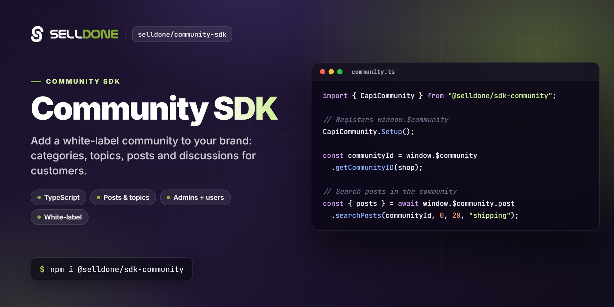

<p align="center">
  
</p>

<p align="center">
  <a href="https://www.npmjs.com/package/@selldone/sdk-community"></a>
  <a href="https://www.npmjs.com/package/@selldone/sdk-community"></a>
  <a href="LICENSE.md"></a>
  <a href="https://github.com/selldone/community-sdk/wiki"></a>
  <a href="https://selldone.com"></a>
</p>

<p align="center">
  <b>The API client for Selldone communities: build, manage and display a white-label community of categories, topics, posts and comments, for both admins and members.</b><br>
  <a href="https://github.com/selldone/community-sdk/wiki">Documentation</a> ·
  <a href="#quick-start">Quick start</a> ·
  <a href="https://github.com/selldone">Ecosystem</a> ·
  <a href="https://selldone.com">Selldone.com</a> ·
  <a href="https://github.com/selldone/community-sdk/issues">Report an issue</a>
</p>

<p align="center">
  <a href="https://github.com/selldone/storefront">Storefront</a> ·
  <a href="https://github.com/selldone/pagebuilder">Page Builder</a> ·
  <a href="https://github.com/selldone/components">Components</a> ·
  <a href="https://github.com/selldone/storefront-sdk">Storefront SDK</a> ·
  <a href="https://github.com/selldone/backoffice-sdk">Backoffice SDK</a> ·
  <a href="https://github.com/selldone/vendor-sdk">Vendor SDK</a> ·
  <b>Community SDK</b> ·
  <a href="https://github.com/selldone/core">Core</a> ·
  <a href="https://github.com/selldone/cli">CLI</a> ·
  <a href="https://github.com/selldone/translate">Translate</a>
</p>

## Overview

**Community SDK** (`@selldone/sdk-community`) is the TypeScript client for the community API of
[Selldone®](https://selldone.com) Business OS. A Selldone shop can run its own branded community, organized in
categories and topics, where customers post, comment, react, vote in polls and follow each other. The community is
served under the shop's own URL (at `/community`) and runs on Selldone, with no backend for you to host.

The SDK registers `window.CAPI`, a catalog of community API URL builders (communities, categories, topics, posts,
comments, moderators, followers and more), and `window.$community`, a small typed client for community info, post
search and community routing. It powers the `/community` pages of the official
[Storefront](https://github.com/selldone/storefront) and the community UI in
[Components](https://github.com/selldone/components).

Use it when you build a custom storefront with a community, a standalone community front end, or admin tools for
moderating a community.

## Key features

- **One setup call** — `CapiCommunity.Setup()` registers `window.CAPI` and `window.$community`.
- **Community info and statistics** — `$community.getInfo()` returns the community, its categories and time-series data for a chosen time window.
- **Post search** — `$community.post.searchPosts()` searches posts with offset pagination and a `more` flag.
- **Shop-aware community ID** — `$community.getCommunityID(shop)` resolves a shop's community, or the main Selldone community when no shop is given.
- **Router integration** — `$community.routes` exposes the community route names used by the Storefront (`CommunityHomePage`, `CommunityCategoryPage`, `CommunityTopicPage`).
- **Complete URL catalog** — `window.CAPI` covers categories, topics, posts, comments, reactions, polls, reports, moderators, followers, bots and attachments.
- **Shareable links** — the `CommunityURLs` helper builds community, post, comment, embed and short topic links.
- **Caching and cancellation** — `.optimize()`, `.force()`, `.cancellation()` and `.cache()` from Selldone Core.

## Quick start

**1. Install**

```bash
npm install @selldone/sdk-community
```

```bash
yarn add @selldone/sdk-community
```

**2. Configure the endpoint**

```html
<meta name="service-url" content="https://selldone.com">
<meta name="selldone-capi" content="https://capi.selldone.com">
```

**3. Initialize and make your first call**

```js
import { CapiCommunity } from "@selldone/sdk-community";

// ━━━ Community SDK (capi) ━━━
CapiCommunity.Setup(); // Registers window.CAPI and window.$community

const communityId = window.$community.getCommunityID(shop);

const { community, categories } = await window.$community.getInfo(communityId);

const { posts, more } = await window.$community.post.searchPosts(communityId, 0, 20, "shipping");
```

In a storefront, set up the [Storefront SDK](https://github.com/selldone/storefront-sdk) first: it initializes
Selldone Core and sets the signed-in customer's `Authorization` header on `window.axios`, which the community
requests reuse. The Community SDK does not manage authentication itself.

## Usage

### `window.$community`

| Member | Description | Route |
|---|---|---|
| `getInfo(community_id, offset?, days?)` | Community, categories and statistics (`{ community, categories, data }`) | `GET /communities/{community_id}` |
| `post.searchPosts(community_id, offset, limit, search)` | Search posts (`{ posts, more }`) | `GET /communities/{community_id}/search` |
| `getCommunityID(shop?)` | The shop's community ID, or `1` (the main Selldone community) without a shop | — |
| `routes` | Route names: `COMMUNITY_HOME_PAGE`, `COMMUNITY_CATEGORY_PAGE`, `COMMUNITY_TOPIC_PAGE` | — |

### Calling the rest of the community API

Everything else (feeds, topics, posts, comments, reactions, moderation) is available as URL builders on
`window.CAPI`:

```js
// Load the community feed
const { data } = await window.axios.get(window.CAPI.GET_COMMUNITY_FEED(communityId), {
  params: { offset: 0, limit: 10 },
});

// React to a post
await window.axios.post(
  window.CAPI.POST_COMMUNITY_TOPIC_POST_REACTION(communityId, topicId, postId),
  { reaction },
);
```

See [Community API URL Builders](https://github.com/selldone/community-sdk/wiki/Community-API-URL-Builders) for the
full catalog.

### Shareable links

```js
import { CommunityURLs } from "@selldone/sdk-community/url/CommunityURLs";

CommunityURLs.CommunityUrl(shop);        // <shop URL>/community
CommunityURLs.PostUrl(shop, post);       // <shop URL>/POSTS/{post_id}
CommunityURLs.PostEmbedUrl(shop, post);  // <selldone-iframe URL>/POSTS/{post_id}/embed
```

## Documentation

| Page | What you'll learn |
|---|---|
| [Getting Started](https://github.com/selldone/community-sdk/wiki/Getting-Started) | Install, configure and make your first calls |
| [JavaScript SDK](https://github.com/selldone/community-sdk/wiki/JavaScript-SDK) | `window.$community` members, parameters and responses |
| [Community API URL Builders](https://github.com/selldone/community-sdk/wiki/Community-API-URL-Builders) | The full `window.CAPI` catalog with request examples |
| [Links and Routes](https://github.com/selldone/community-sdk/wiki/Links-and-Routes) | `CommunityURLs` share links and Vue Router route names |
| [FAQ](https://github.com/selldone/community-sdk/wiki/FAQ) | Common questions and troubleshooting |

## How it fits in the ecosystem

The Community SDK is a companion of the [Storefront SDK](https://github.com/selldone/storefront-sdk): the storefront
handles the customer session and shop data, and the Community SDK adds the community API. The
[Components](https://github.com/selldone/components) package provides the ready-made community UI (layout, feed,
category and topic pages, post editor, comments), and the [Storefront](https://github.com/selldone/storefront) wires
it all together under `/community`.

<a href="https://github.com/selldone#ecosystem"></a>

| Related project | Why you'd use it |
|---|---|
| [Storefront](https://github.com/selldone/storefront) | A complete storefront with community pages built in |
| [Storefront SDK](https://github.com/selldone/storefront-sdk) | Customer session and shop data for your community front end |
| [Components](https://github.com/selldone/components) | Vue 3 community UI: feed, topics, posts, comments, moderation |
| [Core](https://github.com/selldone/core) | Community models (`Community`, `CommunityPost`, …) and helpers |
| [Translate](https://github.com/selldone/translate) | Translations for community and storefront UI |

## Contributing

Contributions are welcome. Please read the organization
[contributing guide](https://github.com/selldone/.github/blob/main/CONTRIBUTING.md) and
[code of conduct](https://github.com/selldone/.github/blob/main/CODE_OF_CONDUCT.md). To develop this package together
with a consuming project, use `yarn link` as described in [DEVELOPMENT.md](DEVELOPMENT.md).

New community endpoints belong in `apis/CAPI.ts` as URL builders.

## Security

Please do not report vulnerabilities in public issues. Email **security@selldone.com**. See the organization
[security policy](https://github.com/selldone/.github/blob/main/SECURITY.md).

## License

See [LICENSE.md](LICENSE.md).

<details>
<summary><b>Selldone Ecosystem License Agreement</b></summary>

1. **Scope of License**: This license is granted exclusively for the use of the enclosed code (hereinafter referred to as "the Code") within the Selldone ecosystem. The licensee is authorized to use the Code solely in conjunction with services and applications that are part of, or directly related to, the Selldone ecosystem.

2. **Commercial Use Restriction**: The licensee is strictly prohibited from using the Code for any commercial purposes outside the Selldone ecosystem. Commercial utilization is permissible only when it is within the Selldone ecosystem and in accordance with the terms of this agreement.

3. **Permission for Free Use**: The Code may be used for non-commercial, free services, provided that explicit credit is given to Selldone. This credit must include the name "Selldone" prominently displayed on the user interface of the relevant service or application, along with a hyperlink to [selldone.com](https://selldone.com).

4. **No Redistribution**: The licensee may not redistribute the Code, in whole or in part, to any third party outside the Selldone ecosystem, unless expressly authorized by Selldone.

5. **No Modification for Redistribution**: While modifications to the Code for personal or internal use within the Selldone ecosystem are allowed, the licensee may not modify the Code for the purpose of redistribution outside the Selldone ecosystem.

6. **Termination**: Failure to comply with the terms of this agreement will result in the immediate termination of the license and may subject the licensee to legal action.

7. **Disclaimer of Warranty**: The Code is provided "as is" without any warranties of any kind, either expressed or implied, including but not limited to implied warranties of merchantability or fitness for a particular purpose.

8. **Limitation of Liability**: In no event shall Selldone be liable for any damages arising out of the use or inability to use the Code.

9. **Jurisdiction and Disputes**: This agreement shall be governed by the laws of the jurisdiction where Selldone is established. Any disputes arising from this agreement shall be resolved in the courts of that jurisdiction.

By using the Code, the licensee acknowledges that they have read, understood, and agreed to the terms of this license.

</details>

---

<p align="center"><sub>Part of the <a href="https://github.com/selldone">Selldone® Business OS</a> open-source ecosystem · <a href="https://selldone.com">selldone.com</a></sub></p>
